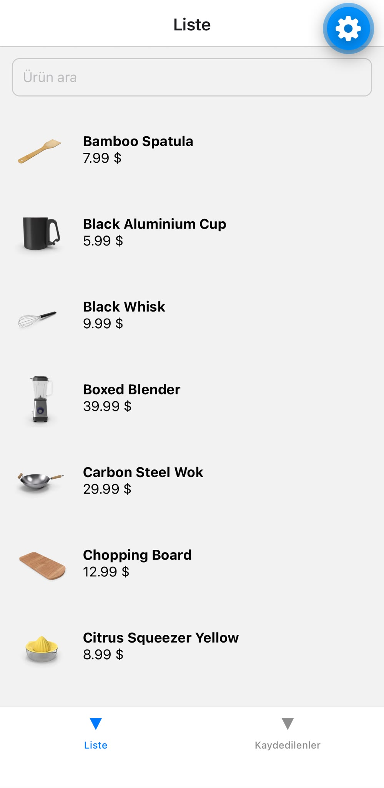
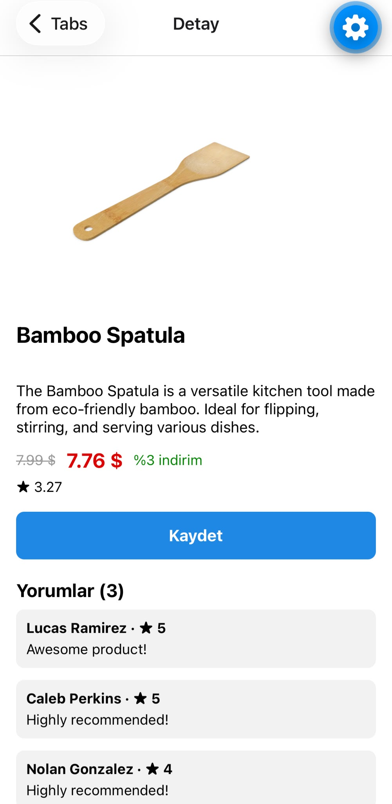
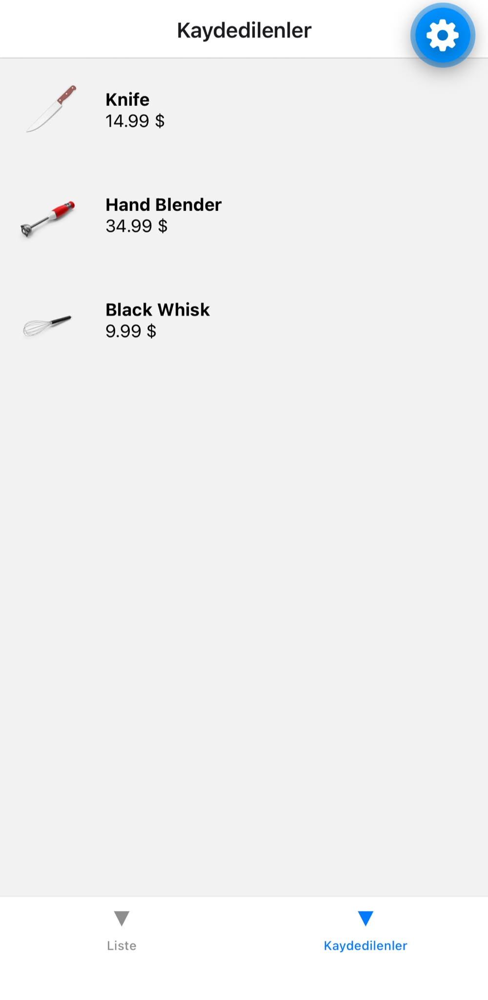

# bsm447-odev-G221210079

## Öğrenci Bilgileri

- **Öğrenci No:** G221210079
- **Konu:** K03 Online Mağaza
- **Varyant:** c) Mutfak gereçleri
- **Veri kaynağı:** https://dummyjson.com/products/category/kitchen-accessories
- **Ek kural:** 8 · Son 5 arama

## Uygulama Hakkında

Uygulama, DummyJSON API'sinden mutfak gereçleri kategorisindeki ürünleri çeker ve üç ekranda gösterir:

- **Liste:** Ürünler görsel, ad ve fiyatla listelenir. Üstteki arama kutusu listeyi büyük/küçük harfe duyarsız süzer. Arama yapılınca terim son 5 arama olarak çip şeklinde görünür, çipe dokunulunca o arama tekrarlanır.
- **Detay:** Seçilen ürünün görselleri, marka, açıklama, puan, yorumları ve indirimli fiyatı gösterilir. Stok 10'un altındaysa "Son N ürün" rozeti çıkar. Ürün, "Kaydet" düğmesiyle kaydedilebilir.
- **Kaydedilenler:** Kaydedilen ürünler listelenir. Uygulama kapatılıp açılsa da kayıtlar kalır.

Detay ekranı, kaydı React Navigation'ın `route.params` yapısıyla alır. Veri çekme, arama ve kayıt işlemleri ekran dosyalarında ve `src/storage.js` içinde yapılır.

## Kullanılan Teknolojiler

- React Native + Expo (SDK 58)
- React Navigation (Bottom Tabs + Native Stack)
- AsyncStorage (`@react-native-async-storage/async-storage`)

## Kalıcı Veri Yöntemi

Kaydedilen ürünler ve son aramalar **AsyncStorage** ile cihazda saklanır. Kayıtlar `src/storage.js` dosyasındaki `loadSaved`, `writeSaved`, `loadRecent` ve `addRecent` fonksiyonlarıyla yönetilir.

## Proje Yapısı

```
App.js                      Navigasyon kurulumu
src/storage.js              AsyncStorage işlemleri
src/screens/ListScreen.js   Liste ekranı, arama ve son aramalar
src/screens/DetailScreen.js Detay ekranı ve kaydet düğmesi
src/screens/SavedScreen.js  Kaydedilenler ekranı
```

## Ekran Görüntüleri

| Liste | Detay | Kaydedilenler |
|-------|-------|---------------|
|  |  |  |

## APK

Android APK bağlantısı:
https://expo.dev/accounts/gurelnisanur/projects/bsm447-odev-G221210079/builds/92f7778a-e3a3-449b-b88a-1800c6afb6bc

## Ekran Kaydı

Üç ekranı gösteren kısa kayıt:
[Ekran kaydını izle](https://drive.google.com/file/d/1FaJi2fujjUkh61r0X9BE0hCVleUJIX_D/view?usp=sharing)